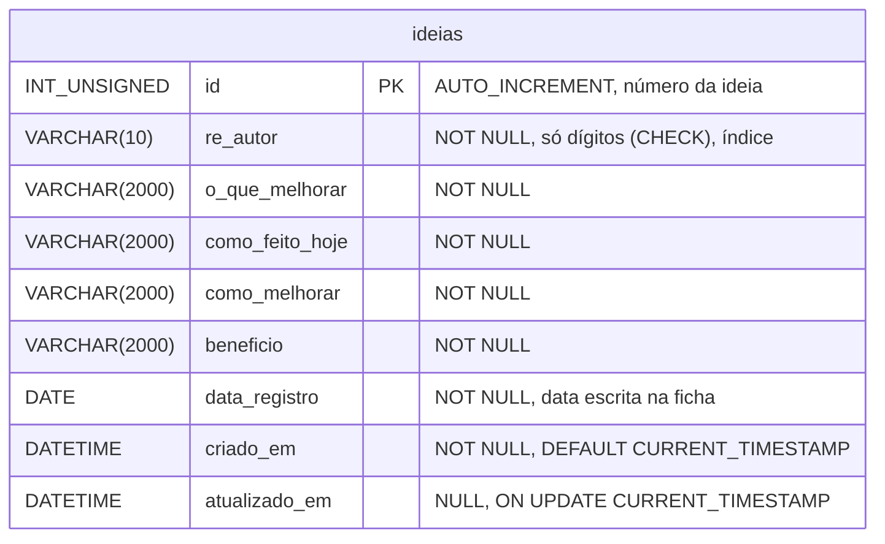
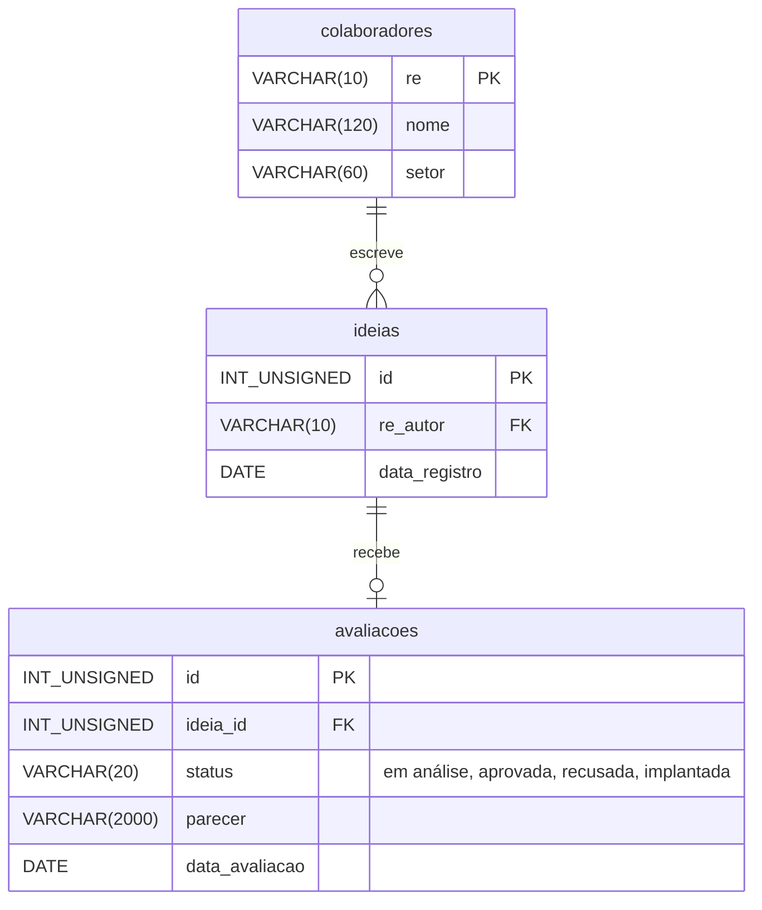

# DER: D+Ideias

O banco `dmais_ideias` tem uma tabela só, `ideias`. Cada linha é uma ficha de papel digitada pelo avaliador da Qualidade.

O SQL completo está em [`database/schema.sql`](../database/schema.sql).

## Campos

| Coluna | Tipo | Regra | Por quê |
|---|---|---|---|
| `id` | `INT UNSIGNED` PK `AUTO_INCREMENT` | Gerado pelo banco | É o número da ideia ("Ideia 12"). O banco gera, então nunca se repete. `UNSIGNED` porque id nunca é negativo. |
| `re_autor` | `VARCHAR(10)` | `NOT NULL`, só dígitos (`CHECK`) | RE é um identificador, não uma quantidade: pode ter zero à esquerda (`0587`) e ninguém faz conta com ele. Como `INT`, o `0587` viraria `587`. |
| `o_que_melhorar` | `VARCHAR(2000)` | `NOT NULL` | Campo 1 da ficha. |
| `como_feito_hoje` | `VARCHAR(2000)` | `NOT NULL` | Campo 2 da ficha. |
| `como_melhorar` | `VARCHAR(2000)` | `NOT NULL` | Campo 3 da ficha. |
| `beneficio` | `VARCHAR(2000)` | `NOT NULL` | Campo 4 da ficha. |
| `data_registro` | `DATE` | `NOT NULL` | A data escrita na ficha. Só dia, sem hora, porque é isso que a ficha tem. |
| `criado_em` | `DATETIME` | `DEFAULT CURRENT_TIMESTAMP` | Auditoria: quando a ficha foi digitada. É diferente de `data_registro`, porque as fichas ficam até um mês na urna. |
| `atualizado_em` | `DATETIME` | `NULL`, `ON UPDATE CURRENT_TIMESTAMP` | Auditoria: última edição. `NULL` quer dizer que nunca foi editada. |

## Decisões

**Uma tabela só.** O case pede o RE como um campo simples, sem cadastro de colaboradores. Criar uma tabela `colaboradores` sem ter os dados dela seria inventar requisito.

**`VARCHAR(2000)` e não `TEXT`.** A validação limita cada texto a 2000 caracteres. Com `VARCHAR(2000)`, o banco também recusa um texto maior (erro `1406 Data too long`), mesmo se alguém inserir fora da aplicação.

**`CHECK` no RE.** A regra "só dígitos" também vale no banco: `INSERT` com `re_autor = '12A4'` falha com `CONSTRAINT chk_ideias_re_autor failed`.

**"Data não futura" fica só no backend.** O MariaDB não aceita `CURDATE()` dentro de um `CHECK` (erro `1901`), porque uma regra que muda de resultado com o passar dos dias não pode ser garantida pelo banco.

**Índices.** Além da chave primária, existe só `idx_ideias_re_autor`, usado na busca por RE (`WHERE re_autor = ?`). O `EXPLAIN` mostra `type: ref` com esse índice. A busca no texto (`LIKE '%termo%'`) não consegue usar índice, porque começa com `%`. Com o volume de ideias de uma fábrica (centenas por ano), ler a tabela inteira é instantâneo. Não há índice em `data_registro` porque nenhuma consulta filtra ou ordena por ela (a lista ordena por `id`, que já é a PK). Ele entra junto com um filtro por período.

**`utf8mb4` + `utf8mb4_unicode_ci`.** `utf8mb4` guarda qualquer caractere. A collation `unicode_ci` faz as comparações ignorarem maiúsculas e acentos: buscar `identificacao` encontra "Identificação".

**`InnoDB`.** É o motor padrão do MariaDB, com transações e chaves estrangeiras (necessárias na próxima versão).

## Próxima versão (não implementado)

Se o programa crescer, o RE vira chave estrangeira para uma tabela de colaboradores, e a avaliação ganha uma tabela própria:

